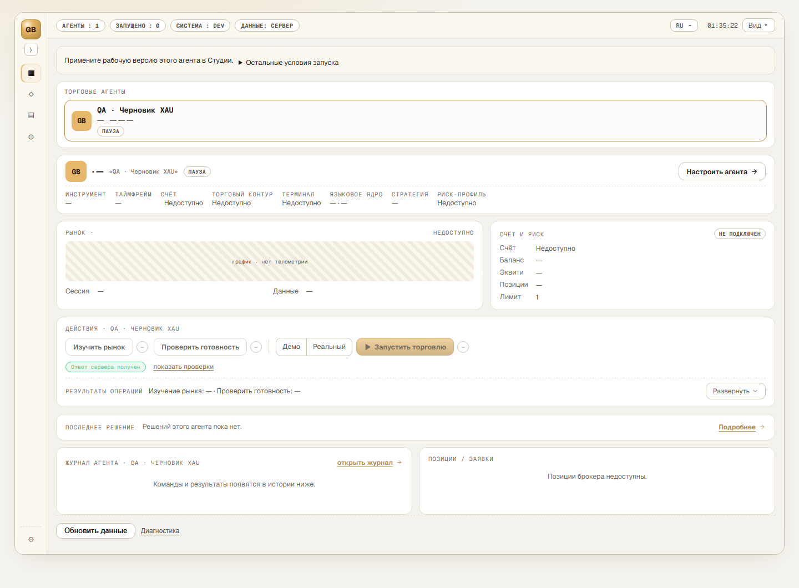

# Golden Breeze

**Агентная платформа для разработки, проверки и использования торговых стратегий.**

Golden Breeze развивается как самостоятельная мультиагентная платформа: от исследования рынка, обучения и создания стратегий — к управлению торговыми направлениями и инвестиционным портфелем. В основе — единое приложение для Windows, понятное состояние работы и явное управление действиями. Мы развиваем платформу от Пульта управления к пути **«идея → код стратегии → проверки → версия → выбор и применение»**.

[Состояние и развитие](docs/roadmap.md) · [Выпуски](https://github.com/nikolaykazakovvs-ux/golden-breeze-releases/releases) · [Первый запуск](docs/first-start.md) · [Партнёрам и спонсорам](#партнёрам-и-спонсорам)

> **Alpha · проект развивается.** Есть реализованная основа во внутренних сборках; общий установщик ещё не опубликован. Возможности, принятые для конкретного выпуска, описываются в его заметках. Направления развития ниже не означают, что все функции уже доступны.

## Что есть сейчас

- **Пульт и настройка торговых агентов.** Состояние агентов, конфигурация, проверка, версии и явное применение настроек собраны в одном рабочем пространстве. Запуск и остановка — отдельные действия.
- **Счета и контроль исполнения.** Реализован путь подключения через MetaTrader 5 (MT5), настройки провайдеров искусственного интеллекта (ИИ), проверки готовности и ограничений. Тип счёта, выбранная стратегия и допуск к торговле проверяются отдельно.
- **История и основа разговорного агента.** Интегрировано ядро с сохранением сообщений, историей и очередью задач, чтением состояния, ограниченным делегированием и отменой. Полная пользовательская приёмка разговорного агента остаётся отдельным этапом.
- **Обновление Windows-приложения.** Штатное обновление по кнопке с сохранением профилей и видимой истории проверено на ПК оператора 9 октября 2026 года. Подготовка первого общего выпуска продолжается.

Это основа внутренних сборок, а не перечень уже выпущенных возможностей для всех пользователей. Demo и real входят в общую модель подключаемых счетов; завершённая приёмка исполнения на реальном счёте здесь не заявляется.

<strong>Посмотреть Пульт управления</strong>

*Интерфейс от 6 сентября 2026 года: тестовый агент, счёт не подключён. Экран показывает устройство рабочего пространства; возможности выбранной версии описываются в её заметках к выпуску.*

## Сейчас в работе — 10 октября 2026

Исправляем сохранение результатов «Ревью поведения» для версий стратегий, поставляемых без исходного кода. Следующий результат — проверка исправления в установленной программе.

Готовим общий установщик и пользовательскую доставку. Сводим развитие платформы в единый план: разговорный агент, создание исполняемых стратегий, знания, торговые подключения и доставка приложения. В плане ближайшие поставки отделены от будущих возможностей.

## Куда развиваемся

Ближайшее направление — удобный сохраняемый разговор, в котором агент помогает разобраться в задаче, создаёт настоящий код стратегии и доводит проверенную версию до каталога. Пользователь видит условия, риск и статус; исходный код открывается по запросу. Полная Studio с редактором и историческими прогонами запланирована отдельно и не должна задерживать первый путь от идеи к проверенной стратегии.

Целевой объём включает личную библиотеку учебных материалов, веб-поиск с источниками, память и профильных агентов. Параллельно развиваем каталог торговых платформ и подключений. TradeLocker — отдельное направление интеграции; присутствие названия платформы в интерфейсе не означает готовое подключение.

Дальнейшие направления — сохранённые рабочие процессы, применение проверенных правил риска, совместная работа нескольких торговых исполнителей, управление портфелем и рыночная аналитика. Расширенная Studio, исторический движок и фондовые сценарии требуют отдельных решений и проверок.

[Карта направлений и их состояния →](docs/roadmap.md)

## Скачать и начать работу

**Проверенный установщик для общей раздачи пока не опубликован.** Когда он будет доступен, его можно будет получить в [разделе Releases](https://github.com/nikolaykazakovvs-ux/golden-breeze-releases/releases). Там же будут описание изменений, ограничения, контрольная сумма и сведения о подписи издателя.

Приложение предназначено для **Windows x64**. Поддержанные версии Windows, требования к торговому терминалу и провайдеру ИИ будут указаны вместе с установщиком. Архивы **Source code**, автоматически создаваемые GitHub, содержат материалы этой страницы и не являются установщиком Golden Breeze.

[Установка и первый запуск →](docs/first-start.md)

Инструкция готовится к первому внешнему выпуску. После первоначальной установки обновления приходят с собственного сервера Golden Breeze: программа уведомляет о новой версии, а применение начинается по кнопке **«Обновить»** в безопасном состоянии. GitHub-аккаунт для дальнейших обновлений не нужен. Проверка общего пользовательского канала остаётся частью подготовки выпуска.

## Партнёрам и спонсорам

Ищем сотрудничество вокруг конкретных возможностей продукта: интеграций с торговыми платформами и поставщиками данных, независимой проверки стратегий и приложения, инфраструктуры, документации и учебных материалов. Обратная связь пилотных пользователей помогает проверить рабочие сценарии и понятность интерфейса.

Поддержку предлагаем связывать с конкретной поставкой и проверяемым результатом. Состояние работы, ограничения и завершённые проверки должны быть понятны участникам. Формат сотрудничества и условия поддержки обсуждаем отдельно.

[Обсудить партнёрство или поддержку →](https://github.com/nikolaykazakovvs-ux/golden-breeze-releases/issues)

Опишите область, в которой готовы участвовать, и результат, который хотите получить совместно с командой.

## Обратная связь

[Задать вопрос или сообщить об ошибке →](https://github.com/nikolaykazakovvs-ux/golden-breeze-releases/issues)

Укажите версию приложения, ожидаемый результат и что произошло. Прикладывайте снимки экрана без паролей, ключей и номеров счетов.

Результаты на demo-счёте или исторических данных не обещают аналогичных результатов на реальном счёте. Golden Breeze не гарантирует доходность.
